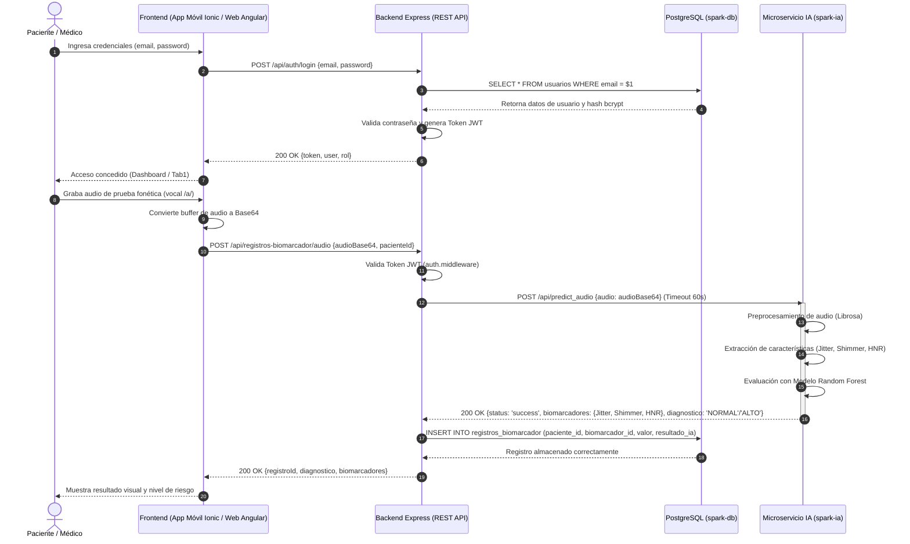
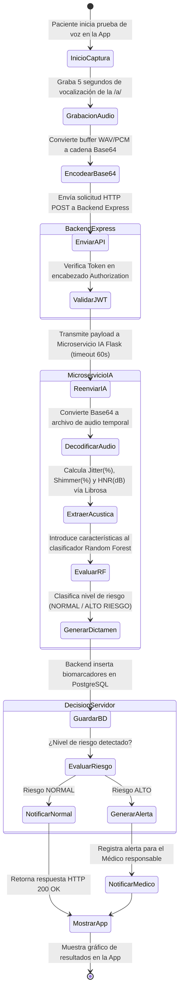

# 📐 Documentación de Arquitectura UML - Sistema S-Park

Este documento contiene el modelado UML formal del ecosistema **S-Park** (Panel Web Angular, App Móvil Ionic/Capacitor, Backend Express REST API, BD PostgreSQL y Microservicio IA Python Flask). Incluye los diagramas Mermaid renderizables de **Establecimiento de Comunicación / Actividad** y **Modelado de Componentes**, junto con los **Prompts detallados** para herramientas externas y la descripción técnica de cada componente.

---

## 1. a) Establecimiento de Comunicación e Interacción

### 1.1. Diagrama de Secuencia UML (Comunicación entre Componentes)

#### 🎨 Diagrama Mermaid


#### 📝 Prompt Detallado para Herramientas (PlantUML / Eraser.io / ChatGPT)
```text
Crea un Diagrama de Secuencia UML formal en sintaxis PlantUML o Mermaid que ilustre el flujo completo de comunicación entre los componentes del sistema de salud S-Park.
Los participantes son:
1. Paciente / Médico (Actor)
2. Frontend (App Móvil Ionic / Web Angular)
3. Backend Express (REST API Gateway en Node.js)
4. Base de Datos Relacional PostgreSQL
5. Microservicio IA Flask (Python / Random Forest)

Pasos requeridos:
- Inicio de sesión con autenticación basada en Tokens JWT e inspección de hashes en PostgreSQL.
- Captura de audio de voz fonética por el micrófono del dispositivo.
- Conversión a Base64 y transmisión mediante HTTP POST con timeout de 60 segundos hacia el backend.
- Transmisión síncrona hacia el microservicio de IA para preprocesamiento de señal acústica con la librería Librosa.
- Clasificación de patrones con el modelo de ensamble Random Forest.
- Persistencia de los biomarcadores acústicos (Jitter, Shimmer, HNR) en PostgreSQL.
- Retorno de la respuesta con feedback visual en el dispositivo del usuario.
```

---

### 1.2. Diagrama de Actividades UML (Flujo del Proceso de Análisis de Voz)

#### 🎨 Diagrama Mermaid


#### 📝 Prompt Detallado para el Diagrama de Actividades
```text
Genera un Diagrama de Actividades UML en sintaxis Mermaid/PlantUML que describa el flujo de trabajo del procesamiento de voz asistido por Inteligencia Artificial en S-Park.
Fases a incluir:
1. Cliente: Captura de voz de 5 segundos de la vocal /a/, conversión a Base64 y envío al backend.
2. Backend Express: Validación de seguridad JWT y transmisión al microservicio de IA con timeout de 60 segundos.
3. Microservicio IA Python: Decodificación del audio, extracción bioacústica con Librosa (Jitter %, Shimmer %, HNR dB) y clasificación con el algoritmo Random Forest.
4. Base de Datos: Almacenamiento de biomarcadores y generación de alerta clínica en caso de detectar Riesgo Alto.
```

---

## 2. c) Modelado de Componentes

### 2.1. Diagrama de Componentes UML

#### 🎨 Diagrama Mermaid
```mermaid
componentDiagram
    package "Capa de Presentación (Frontend)" {
        [App Móvil Ionic/Capacitor] as AppMovil
        [Panel Web Angular Admin] as PanelWeb
    }

    package "Capa de Servicios y API (Backend Node.js)" {
        component [Express REST API Gateway] as Gateway {
            [Auth Controller & Middleware JWT] as ModAuth
            [Pacientes Controller] as ModPacientes
            [Registros & Voz Controller] as ModRegistros
            [ORM / Query Client (pg Pool)] as ModDB
        }
    }

    package "Capa de Inteligencia Artificial (Python)" {
        component [Flask IA Microservice] as ServicioIA {
            [Audio Preprocessor (Librosa)] as Preproc
            [Feature Extractor (Jitter/Shimmer/HNR)] as Extractor
            [Random Forest Classifier (Scikit-Learn)] as RFModel
        }
    }

    database "Capa de Datos" {
        [PostgreSQL Database (spark-db)] as Postgres
    }

    AppMovil --> Gateway : HTTP / REST (JSON)
    PanelWeb --> Gateway : HTTP / REST (JSON)
    
    ModAuth --> ModDB
    ModPacientes --> ModDB
    ModRegistros --> ModDB
    
    ModRegistros --> ServicioIA : HTTP POST /api/predict_audio (Timeout 60s)
    Preproc --> Extractor
    Extractor --> RFModel

    ModDB --> Postgres : SQL Queries (pg pool)
```

---

### 2.2. Descripción Técnica de cada Componente

#### 📱 1. Capa de Presentación (Frontend)
* **App Móvil (Ionic / Capacitor / Angular):**
  * **Responsabilidad:** Proporcionar la interfaz nativa e interactiva para los pacientes. Permite realizar la captura directa de voz mediante el micrófono del dispositivo, la visualización de la racha de días de ejercicio, citas médicas y notificaciones de salud.
  * **Tecnologías:** Ionic 7, Angular 21, Capacitor Audio Plugin, RxJS.
* **Panel Web Administrativo (Angular SPA):**
  * **Responsabilidad:** Interfaz de cuadro de mando (Dashboard) para médicos y administradores. Permite gestionar expedientes clínicos, evaluar gráficos de evolución de biomarcadores (Jitter/Shimmer/HNR) y asignar médicos a pacientes.
  * **Tecnologías:** Angular 21, Chart.js / Recharts, CSS Glassmorphism.

#### ⚙️ 2. Capa de Servicios y API (Backend REST)
* **Express REST API Gateway (`spark-backend`):**
  * **Responsabilidad:** Orquestador central de lógica de negocio, autenticación, seguridad y persistencia.
  * **Módulos clave:**
    * `AuthMiddleware`: Verifica y valida tokens criptográficos JWT en cada solicitud protegida.
    * `PacientesService`: Asigna automáticamente médicos a pacientes al crearse y administra la racha de bienestar.
    * `RegistrosService`: Recibe los audios en Base64, los reenvía al microservicio de IA en Python con un timeout de 60 segundos y guarda los diagnósticos resultantes en la BD.
    * `pg Pool Client`: Gestor de conexiones concurrentes hacia la base de datos PostgreSQL.

#### 🤖 3. Capa de Inteligencia Artificial (Microservicio Python Flask)
* **Microservicio IA (`spark-ia`):**
  * **Responsabilidad:** Servicio especializado para el análisis bioacústico de voz y diagnóstico predictivo.
  * **Sub-componentes:**
    * `Audio Preprocessor`: Recibe la cadena Base64, la convierte a archivo `.wav` temporal y realiza la normalización de la onda sonora con **Librosa**.
    * `Feature Extractor`: Extrae las métricas acústicas de perturbación de frecuencia (**Jitter %**), perturbación de amplitud (**Shimmer %**) y relación armónico-ruido (**HNR dB**).
    * `Random Forest Classifier`: Modelo de aprendizaje supervisado previamente entrenado con `scikit-learn` / `joblib`. Clasifica la señal de voz determinando la probabilidad de patrón patológico compatible con Parkinson.

#### 🗄️ 4. Capa de Datos (Base de Datos Relacional)
* **PostgreSQL Engine (`spark-db`):**
  * **Responsabilidad:** Almacenamiento persistente e inmutable de cuentas de usuario, hashes bcrypt de contraseñas, perfiles de médicos y pacientes, expedientes clínicos y serie de tiempo de biomarcadores de voz.

---

### 📝 Prompt Detallado para el Diagrama de Componentes (PlantUML / Eraser.io)
```text
Genera un Diagrama de Componentes UML formal en sintaxis PlantUML o Mermaid que describa la arquitectura del sistema de monitoreo de Parkinson S-Park.
El diagrama debe estar organizado en 4 capas principales:
1. Capa de Presentación:
   - Componente 'App Móvil Ionic' (dispositivo paciente con captura de micrófono).
   - Componente 'Panel Web Angular' (dashboard médico con gráficas).
2. Capa de Aplicación REST API (Node.js/Express):
   - Módulo de Autenticación JWT.
   - Módulo de Control de Pacientes y Expedientes.
   - Módulo de Análisis de Registros de Voz (con timeout de 60s).
   - Cliente Pool PostgreSQL.
3. Capa de Inteligencia Artificial (Python/Flask):
   - Preprocesador de Audio Librosa.
   - Extractor de Biomarcadores (Jitter, Shimmer, HNR).
   - Clasificador Random Forest (Scikit-Learn).
4. Capa de Persistencia:
   - Base de Datos Relacional PostgreSQL (spark-db).

Muestra las conexiones HTTP REST entre el Frontend y el API Gateway, la llamada de servicio síncrona de 60 segundos entre el Backend y la IA, y la conexión SQL relacional hacia la base de datos.
```
